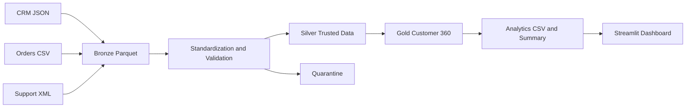

# Customer 360 Data Engineering Pipeline

## Project overview

This project builds a lightweight Bronze-Silver-Gold data pipeline for an
e-commerce customer view. It combines CRM customers, order aggregates, and
support tickets to produce a unified Customer 360 dataset and batch-level
analytics.

### Objectives

- Ingest CRM JSON, Orders CSV, and Support XML data.
- Standardize source schemas and validate input records.
- Quarantine invalid and unmatched records without dropping source evidence.
- Build one Customer 360 row per valid CRM customer.
- Generate five analytics outputs and display them in Streamlit.

## Technology stack

- Python 3.10+
- Pandas and PyArrow
- DuckDB
- Streamlit
- Pytest

## Architecture



CRM is the master customer population. Orders and Support are attached with
left joins. Missing source records are represented as absence/zero only where
documented; invalid quarantined values remain unknown.

## Project structure

- `app.py`: Streamlit dashboard.
- `config/`: pipeline paths and business thresholds.
- `data/raw/`: source batch inputs.
- `data/bronze/`: batch ingestion outputs.
- `data/silver/`: trusted and quarantine outputs plus quality issues.
- `data/gold/`: Customer 360 Parquet output.
- `data/analytics/`: batch analytics outputs.
- `src/ingestion/`: Bronze ingestion.
- `src/quality/`: validation and quality issue generation.
- `src/transformation/`: standardization, Silver, and Gold transformations.
- `src/analytics/`: analytics metrics and batch runner.
- `tests/`: automated tests.
- `docs/`: detailed business, data quality, data dictionary, and KPI rules.

## Prerequisites

- Windows PowerShell
- Python 3.10 or newer
- pip and Git

## Installation

From PowerShell:

```powershell
git clone https://github.com/neha-n-git/Customer360-pipeline.git
cd Customer360-pipeline
py -m venv .venv
.\.venv\Scripts\Activate.ps1
python -m pip install --upgrade pip
python -m pip install -r requirements.txt
```

Place source inputs in a batch folder:

```text
data/raw/<batch_id>/crm_customers.json
data/raw/<batch_id>/orders.csv
data/raw/<batch_id>/support_tickets.xml
```

## Running the pipeline

Run the complete Bronze through Gold pipeline:

```powershell
python -m src.pipeline <batch_id>
```

Run Silver and Gold independently after Bronze exists:

```powershell
python -m src.transformation.run_silver <batch_id>
python -m src.transformation.run_gold <batch_id>
```

Generate analytics after Gold:

```powershell
python -m src.analytics.run_analytics <batch_id>
```

Launch the dashboard:

```powershell
streamlit run app.py
```

Existing batch directories are protected from accidental overwrite. Choose a
new batch ID for every run.

## Dashboard

The dashboard selects an analytics batch and provides:

- Overview metrics and segment distribution.
- Top 10 customers by revenue.
- Customer segmentation counts and percentages.
- High-support customer analysis.
- Revenue and customer counts by city.
- Batch-specific data quality and quarantine metrics.

## Business rules

- CRM is the master population; invalid CRM records do not enter Gold.
- Missing Orders records produce zero order count and lifetime revenue.
- Missing Support records produce zero support tickets.
- Quarantined or unknown values remain null in Gold.
- Gold lifetime value greater than 100000 uses Gold.
- Silver lifetime value from 50000 through 100000 uses Silver.
- Bronze lifetime value below 50000 uses Bronze.
- Unknown lifetime value uses Unknown.
- High-support means more than five support tickets.
- Revenue aggregates valid non-null customer lifetime values.

See the `docs/` directory for the complete definitions and data dictionary.

## Testing

```powershell
python -m pytest -q
```

Tests cover Bronze ingestion, validation, Silver quarantine behavior, Gold
integrity, analytics, and dashboard data-loading helpers.

## Outputs

- Bronze: `data/bronze/<batch_id>/`
- Silver: `data/silver/<batch_id>/`
- Quarantine: `data/silver/<batch_id>/quarantine/`
- Gold: `data/gold/<batch_id>/customer_360.parquet`
- Analytics: `data/analytics/<batch_id>/`

## Troubleshooting

- **Missing input files:** verify the three files under `data/raw/<batch_id>/`.
- **Existing batch output:** choose a new batch ID; outputs are intentionally
  not overwritten.
- **Missing dependencies:** activate `.venv` and reinstall requirements.
- **Invalid Parquet:** remove only a failed staged batch and rerun after fixing
  the source; do not overwrite validated prior batches.
- **Streamlit port conflict:** run `streamlit run app.py --server.port 8502`.
- **Streamlit startup failure:** verify `streamlit` is installed and launch from
  the project root.

## Future improvements

- Additional analytics dimensions.
- Automated data-quality alerting.
- Incremental batch processing.
- Scheduled orchestration and deployment.